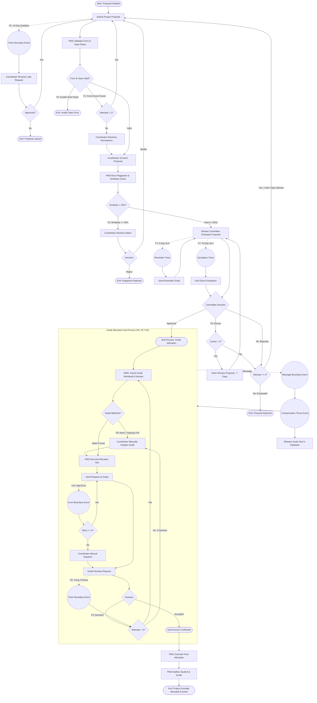

# Assignment 1: Student Project Approval & Allocation System

## 🎯 Scenario Overview
An academic department runs a final-year undergraduate project programme. Every student team must submit a project proposal. The proposal is screened, checked for integrity and duplicate topics, reviewed by a departmental committee, and, once approved, a faculty guide is allocated. The process ends when the allocated faculty guide formally accepts the supervision request and the student team is notified.

---

## 🏛️ Participants & Swimlanes

| Lane | Participant | Responsibilities |
| :--- | :--- | :--- |
| **Lane 1** | **Student / Team** | Submits initial project proposal, rectifies form validation errors, modifies topics upon revision requests, and resubmits. |
| **Lane 2** | **Project Coordinator** | Evaluates late-submission petitions, resolves complex form discrepancies, reviews plagiarism reports, and performs manual guide assignments. |
| **Lane 3** | **Review Committee (incl. HoD)** | Evaluates technical feasibility, syllabus alignment, and novelty; renders Approve/Revise/Reject verdicts; HoD intervenes upon SLA breaches. |
| **Lane 4** | **Faculty Guide** | Receives allocation requests, evaluates personal research capacity, and either accepts or declines supervision. |
| **Lane 5** | **Project Management System (PMS)** | Executes automated form validation, verifies team rules, runs plagiarism similarity algorithms, evaluates guide matching rules, and persists final allocations. |

### Process Boundaries
- **Starts when**: A student team decides to submit a final-year project proposal.
- **Ends when**: A faculty guide is allocated and confirmed, or the proposal is closed as rejected / lapsed.

---

## 🛣️ The Happy Path (Step-by-Step)

```mermaid
flowchart LR
    A([1. Team Submits Proposal]):::student --> B[2. PMS Validates Form & Team]:::system
    B --> C[3. Coordinator Screens Proposal]:::coord
    C --> D[4. PMS Similarity & Plagiarism Check]:::system
    D --> E[5. Committee Evaluates Proposal]:::comm
    E --> F{Committee Decision}:::comm
    F -- "Approved" --> G[6. DMN Checks Guide Workload]:::system
    G --> H[7. PMS Allocates Guide & Sends Request]:::system
    H --> I[8. Guide Accepts Request]:::guide
    I --> J[9. PMS Records Allocation & Notifies Team]:::system
    J --> K([10. End: Project Formally Allocated]):::system

    classDef student fill:#e1f5fe,stroke:#0288d1,stroke-width:2px;
    classDef coord fill:#fff3e0,stroke:#f57c00,stroke-width:2px;
    classDef comm fill:#f3e5f5,stroke:#7b1fa2,stroke-width:2px;
    classDef guide fill:#e8f5e9,stroke:#388e3c,stroke-width:2px;
    classDef system fill:#eceff1,stroke:#455a64,stroke-width:2px;
```

1. **Proposal Submission** (`Task_SubmitProposal` - User Task): Student team enters title, abstract, domain, and roll numbers.
2. **Automated Validation** (`Task_ValidateProposalForm` - Service Task): PMS validates schema compliance and verifies no student is registered twice.
3. **Coordinator Screening** (`Task_CoordinatorScreening` - User Task): Coordinator confirms student academic eligibility and prerequisites.
4. **Plagiarism Check** (`Task_SimilarityCheck` - Service Task): Automated text similarity check calculates similarity index against historical theses.
5. **Committee Evaluation** (`Task_CommitteeEvaluation` - User Task): Departmental committee reviews project novelty and methodology.
6. **Workload Decision Matrix** (`Task_CheckGuideWorkload` - Business Rule Task): DMN engine matches project domain against faculty guide quotas.
7. **Allocation & Notification Dispatch** (`Task_AllocateGuideRecord` & `Task_SendAllocationRequest` - Service + Send Task): PMS reserves slot and dispatches request to guide.
8. **Guide Formal Acceptance** (`Task_GuideResponse` - User Task): Faculty guide reviews and clicks Accept.
9. **Persistence & Team Notification** (`Task_RecordAllocationDB` & `Task_SendFinalNotification` - Service + Send Task): Final state committed to database and confirmation issued.
10. **Success End Event** (`EndEvent_ProjectAllocated`): Final-year project officially begins.

---

## 🔀 Full Process Architecture (Including All Failure Paths F1 – F11)

---

## 📋 BPMN Element Mapping Table & Justification

| Element ID | Element Type | BPMN Notation | Name | Rationale & Justification |
| :--- | :--- | :--- | :--- | :--- |
| `StartEvent_ProposalInitiated` | Start Event | None | Team Decides to Submit Proposal | Instantiates the workflow token upon student team initiation. |
| `Task_SubmitProposal` | User Task | Human Task | Submit Project Proposal | Requires human input from student candidates; candidate group set to `students`. |
| `BoundaryTimer_SubmissionDeadline` | Boundary Event | Timer (Interrupting) | Submission Deadline Missed | Interrupts dormant submissions when departmental intake closes (`P14D`). |
| `Task_ReviewLateSubmissionRequest` | User Task | Human Task | Review Late-Submission Request | Discretionary human review by Project Coordinator. |
| `Gateway_LateApproval` | Exclusive Gateway | XOR Gateway | Approve Late Submission? | Determines whether to re-open submission window or lapse the application. |
| `Task_ValidateProposalForm` | Service Task | External Service | Validate Form & Team Rules | Fully automated backend service validating schema, roll number validity, and team sizes. |
| `Gateway_ValidationCheck` | Exclusive Gateway | XOR Gateway | Form & Team Valid? | Tri-state branching: Valid vs Illegal Team Composition vs Recoverable Form Errors. |
| `EndEvent_InvalidTeam` | End Event | Error End Event | Invalid Team (Rules Violated) | Throws `ERR_INVALID_TEAM`, terminating illegal multi-team registrations cleanly. |
| `Gateway_ValidationAttempts` | Exclusive Gateway | XOR Gateway | Attempts < 2? | Loop limiter guarding against infinite validation retries. |
| `Task_EscalateValidationToCoordinator` | User Task | Human Task | Coordinator Resolves Form Discrepancy | Human fallback when automated validation repeatedly fails due to administrative edge cases. |
| `Task_CoordinatorScreening` | User Task | Human Task | Coordinator Screens Proposal | Academic qualification and prerequisite check by Coordinator. |
| `Task_SimilarityCheck` | Service Task | External Service | Run Similarity Check | Machine service querying NLP/plagiarism vector index for similarity percentage. |
| `Gateway_SimilarityCheck` | Exclusive Gateway | XOR Gateway | Similarity Score < 25%? | Strictly directs tokens exceeding threshold ($\ge 25\%$) into human investigation. |
| `Task_ReviewDuplicateTopic` | User Task | Human Task | Coordinator Reviews Duplicate Match | Academic judgement task comparing overlapping proposals. |
| `Gateway_DuplicateDecision` | Exclusive Gateway | XOR Gateway | Plagiarism Decision | Routes to topic modification loop or outright rejection. |
| `Task_CommitteeEvaluation` | User Task | Human Task | Review Committee Evaluates Proposal | Multi-reviewer evaluation task for committee members. |
| `BoundaryTimer_SLA1_Reminder` | Boundary Event | Timer (Non-Interrupting) | SLA 5 Days: Review Pending | Fires reminder notification without terminating active committee review (`cancelActivity="false"`). |
| `BoundaryTimer_SLA2_HoDEscalation` | Boundary Event | Timer (Interrupting) | SLA 10 Days: Escalate to HoD | Cancels sluggish committee review and elevates directly to Department Head. |
| `Gateway_CommitteeDecision` | Exclusive Gateway | XOR Gateway | Committee Decision | Evaluates verdict (`APPROVED`, `REVISE`, `REJECTED`). |
| `Gateway_RevisionCycles` | Exclusive Gateway | XOR Gateway | Revision Cycles < 2? | Hard limit of 2 revision rounds to protect academic calendar milestones. |
| `Task_ReviseProposalContent` | User Task | Human Task | Revise Proposal (7-Day Limit) | Student task to overhaul proposal within one week. |
| `Gateway_TopicRejectionAttempts` | Exclusive Gateway | XOR Gateway | New Topic Attempt Allowed? | Grants exactly 1 fresh topic proposal before permanent disqualification. |
| `SubProcess_GuideAllocation` | Sub-Process | Embedded Sub-Process | Faculty Guide Allocation Sub-Process | Encapsulates allocation, workload checking, guide acceptance, and compensation logic. |
| `Task_CheckGuideWorkload` | Business Rule Task | DMN / Rule Engine | Check Guide Availability & Workload Matrix | Queries DMN decision table matching research domains with faculty workload caps. |
| `Gateway_GuideMatch` | Exclusive Gateway | XOR Gateway | Matching Guide Found? | Detects capacity saturation or domain mismatch (`'none'`). |
| `Task_ManualGuideAllocation` | User Task | Human Task | Coordinator Manually Assigns Guide | Human supervisor assigns co-guides, adjuncts, or external supervisors. |
| `Task_AllocateGuideRecord` | Service Task | External Service | System Allocates Guide | Atomically reserves faculty guide slot in PMS database. |
| `Task_SendAllocationRequest` | Send Task | Message Task | Send Allocation Request to Guide | Asynchronous email/SMS dispatch to assigned faculty member. |
| `BoundaryError_NotificationFailure` | Boundary Event | Error Catch | Email / DB Failure | Catches SMTP or socket failure on external dispatch. |
| `Gateway_NotificationRetries` | Exclusive Gateway | XOR Gateway | Notification Retry <= 3? | Circuit breaker retry loop with fallback to manual coordinator dispatch. |
| `Task_GuideResponse` | User Task | Human Task | Faculty Guide Reviews Allocation Request | Human acceptance task for faculty guide. |
| `BoundaryTimer_GuideSilent` | Boundary Event | Timer (Interrupting) | 3 Days Silent Timeout | Bypasses non-responsive faculty members after 72 hours. |
| `Gateway_GuideDeclineAttempts` | Exclusive Gateway | XOR Gateway | Decline Retries < 3? | Limits guide decline reruns to 3 before human coordinator intervention. |
| `BoundaryMessage_Withdrawal` | Boundary Event | Message (Interrupting) | Team Withdrawal / Guide Leave | Listens for post-approval cancellation events. |
| `Event_TriggerCompensation` | Intermediate Event | Compensation Throw | Trigger Slot Compensation | Executes compensation handler to undo reserved faculty quotas. |
| `Task_CompensationReleaseGuideSlot` | Service Task | Compensation Handler | Release Allocated Guide Slot in PMS | Undoes state changes when post-approval withdrawal occurs (`isForCompensation="true"`). |
| `Task_RecordAllocationDB` | Service Task | External Service | Record Final Allocation in PMS Database | Commits permanent guide allocation records to production database. |
| `Task_SendFinalNotification` | Send Task | Message Task | Send Allocation Confirmation | Dispatches final formal confirmation to students and faculty. |
| `EndEvent_ProjectAllocated` | End Event | None | Project Formally Allocated & Active | Successful terminal state of the process. |

---

## 🔀 Gateway Condition Expressions

### 1. Validation & Team Check (`Gateway_ValidationCheck`)
- **Valid Flow**: `${isFormValid == true && isTeamValid == true}`
- **Invalid Team Rule Flow (F2)**: `${isTeamValid == false}`
- **Form Errors Found Flow (F1)**: `${isFormValid == false && isTeamValid == true}`

### 2. Form Retry Limiter (`Gateway_ValidationAttempts`)
- **Retry Submission**: `${validationAttempts < 2}`
- **Escalate to Coordinator**: `${validationAttempts >= 2}`

### 3. Plagiarism Gateway (`Gateway_SimilarityCheck`)
- **Passed**: `${similarityScore < 25.0}`
- **Flagged (F3)**: `${similarityScore >= 25.0}`

### 4. Committee Decision Gateway (`Gateway_CommitteeDecision`)
- **Approved**: `${committeeDecision == 'APPROVED'}`
- **Revise (F5)**: `${committeeDecision == 'REVISE'}`
- **Rejected (F6)**: `${committeeDecision == 'REJECTED'}`

### 5. Guide Matching Gateway (`Gateway_GuideMatch`)
- **Matched**: `${matchedGuide != null && matchedGuide != 'none'}`
- **No Guide Available (F8)**: `${matchedGuide == null || matchedGuide == 'none'}`

### 6. Guide Decision Gateway (`Gateway_GuideDecision`)
- **Accepted**: `${guideResponse == 'ACCEPTED'}`
- **Declined (F9)**: `${guideResponse == 'DECLINED'}`
