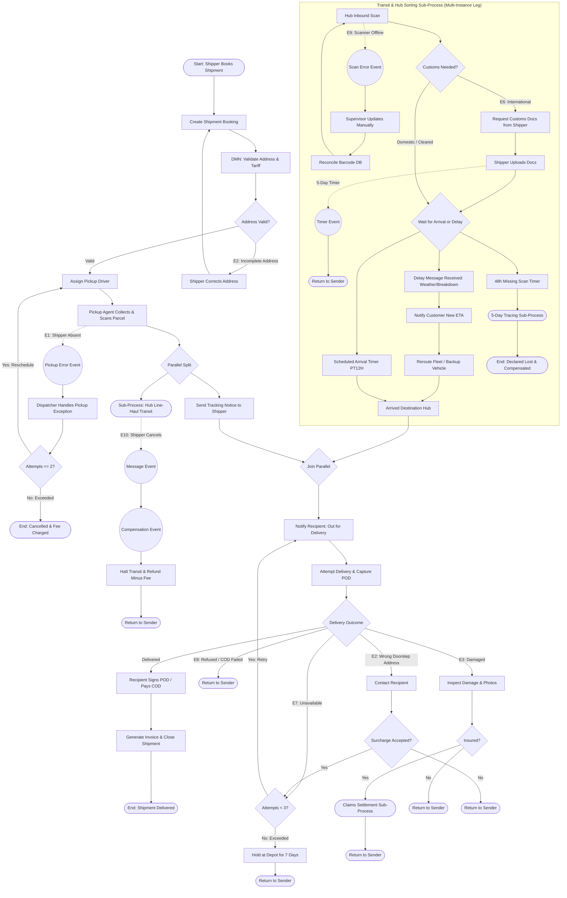

# Assignment 2: Logistics & Shipment Exception Management

## 🎯 Scenario Overview
A nationwide courier and freight logistics provider moves parcels from an originating shipper to a recipient across urban pickup, multi-leg sorting hubs, line-haul line transport, and last-mile doorstep delivery. While standard shipments flow through seamlessly, real-world supply chain networks experience numerous disruptions: missing barcodes, adverse weather, customs documentation deficiencies, unlocatable delivery addresses, and shipper cancellations.

This project models the complete end-to-end shipment lifecycle with emphasis on how exceptions are detected through timers, error events, and messages, and resolved through compensating actions, sub-processes, and bounded retry loops.

---

## 🏛️ Participants & Swimlanes (7 Lanes)

| Lane | Participant | Responsibilities |
| :--- | :--- | :--- |
| **Lane 1** | **Shipper / Customer** | Books consignment, corrects initial address issues, uploads cross-border customs declarations, and initiates recall cancellations if needed. |
| **Lane 2** | **Control Tower / Dispatcher** | Monitors line-haul progress, handles pickup exceptions, reroutes delayed fleet vehicles, updates ETAs, and oversees network SLAs. |
| **Lane 3** | **Pickup Agent** | Executes doorstep pickup, weighs parcel, scans initial waybill, and triggers exceptions if shipper is unavailable. |
| **Lane 4** | **Hub / Warehouse** | Performs high-speed sorter barcode scanning, investigates scanner faults, handles customs document holds, conducts bay damage inspections, and holds unclaimed parcels. |
| **Lane 5** | **Delivery Agent** | Manages out-for-delivery route, resolves doorstep address ambiguity, collects Cash-on-Delivery (COD), and captures electronic Proof of Delivery (POD). |
| **Lane 6** | **Recipient** | Verifies parcel receipt, inspects carton exterior, signs electronic POD or provides OTP, and pays COD amounts. |
| **Lane 7** | **Claims Department** | Assesses damage claims, conducts 5-day lost parcel investigations, processes statutory insurance disbursements, and finalizes freight billing. |

### Process Boundaries
- **Starts when**: A shipper books a consignment through the digital shipping portal.
- **Ends when**: The shipment is successfully delivered and invoiced, returned to sender (RTS), or closed as lost or cancelled.

---

## 🛣️ The Happy Path (Step-by-Step)

```mermaid
flowchart LR
    A([1. Shipper Books Shipment]):::shp --> B[2. DMN Validates Address & Tariff]:::ct
    B --> C[3. Dispatcher Schedules Driver]:::ct
    C --> D[4. Pickup Agent Scans Parcel]:::pck
    D --> E{Parallel Split}:::hub
    E --> F[5a. Hub Line-Haul Transit Leg]:::hub
    E --> G[5b. Real-Time Tracking Notice Sent]:::hub
    F --> H{Parallel Join}:::hub
    G --> H
    H --> I[6. Recipient Notified Out-for-Delivery]:::del
    I --> J[7. Delivery Agent Hands Over & POD Captured]:::del
    J --> K[8. Recipient Signs & Pays COD]:::rec
    K --> L[9. System Invoices & Closes Shipment]:::clm
    L --> M([10. End: Shipment Delivered]):::clm

    classDef shp fill:#e3f2fd,stroke:#1565c0,stroke-width:2px;
    classDef ct fill:#fff8e1,stroke:#f57f17,stroke-width:2px;
    classDef pck fill:#fbe9e7,stroke:#d84315,stroke-width:2px;
    classDef hub fill:#eceff1,stroke:#455a64,stroke-width:2px;
    classDef del fill:#e8f5e9,stroke:#2e7d32,stroke-width:2px;
    classDef rec fill:#f3e5f5,stroke:#6a1b9a,stroke-width:2px;
    classDef clm fill:#efebe9,stroke:#4e342e,stroke-width:2px;
```

1. **Shipment Booking** (`Task_CreateShipmentBooking` - User Task): Shipper specifies origin, destination address, declared value, and dimensions.
2. **Tariff & Address Check** (`Task_ValidateAddressAndTariff` - Business Rule Task): DMN engine verifies postal routing codes and computes freight rate.
3. **Driver Assignment** (`Task_AssignPickupDriver` - Service Task): Fleet telematics system allocates optimal driver route.
4. **Collection & Inbound Barcode Scan** (`Task_CollectAndScanParcel` - User / Manual Task): Driver arrives, scans waybill, and takes custody.
5. **Parallel Gateway Fork** (`Gateway_ParallelDispatchSplit`): Concurrently runs physical line-haul transit and customer tracking notification dispatch (`Task_SendShipperPickupNotice`).
6. **Hub Line-Haul Transit Sub-Process** (`SubProcess_HubLineHaulTransit` - Multi-Instance Sub-Process): Parcel traverses sorting hubs and line-haul legs.
7. **Out-for-Delivery Dispatch** (`Task_NotifyRecipientOutForDelivery` - Send Task): Local depot scans parcel onto last-mile delivery van and texts recipient.
8. **Doorstep Handover & POD Capture** (`Task_DeliverParcelAndCapturePOD` - User Task): Delivery agent scans recipient signature/OTP.
9. **Recipient Receipt & Sign-Off** (`Task_ReceiveParcelAndProvidePOD` - User Task): Recipient confirms intact condition.
10. **Invoice & Closure** (`Task_CloseShipmentGenerateInvoice` - Service Task): Electronic invoice generated; process reaches `EndEvent_ShipmentDelivered`.

---

## 🔀 Full Process Architecture (Including All Exception Paths E1 – E10)

---

## 📋 BPMN Element Mapping Table & Justification

| Element ID | Element Type | BPMN Notation | Name | Rationale & Justification |
| :--- | :--- | :--- | :--- | :--- |
| `StartEvent_BookingCreated` | Start Event | None | Shipper Books Shipment | Initiates the consignment instance upon order placement. |
| `Task_CreateShipmentBooking` | User Task | Human Task | Create Shipment Booking | Human intake from customer/shipper specifying sender, receiver, dimensions. |
| `Task_ValidateAddressAndTariff` | Business Rule Task | DMN / Rule Engine | Validate Address & Tariff | Executes postal verification algorithms and volumetric freight calculation tables. |
| `Gateway_AddressValidation` | Exclusive Gateway | XOR Gateway | Address Valid? | Diverts flawed addresses to shipper correction before logistical resources are dispatched. |
| `Task_CorrectBookingAddress` | User Task | Human Task | Correct Incomplete Address | Prompts shipper to fix postal code/street errors. |
| `Task_AssignPickupDriver` | Service Task | External Service | Schedule Pickup & Driver | Automated fleet dispatch routing closest available van. |
| `Task_CollectAndScanParcel` | User / Manual Task | Human Task | Collect Parcel & Scan | Driver physically verifies goods and registers initial tracking barcode. |
| `BoundaryError_PickupFailed` | Boundary Event | Error Catch | Shipper Absent / Unready | Catches driver exception when shipper premises are vacant or goods unready. |
| `Task_HandlePickupException` | User Task | Human Task | Dispatcher Handles Pickup Exception | Human dispatcher arbitrates whether to reschedule or forfeit pickup. |
| `Gateway_PickupAttempts` | Exclusive Gateway | XOR Gateway | Pickup Attempts <= 2? | Restricts wasted driver runs to 2 attempts maximum. |
| `EndEvent_BookingCancelledFee` | End Event | Terminate | Booking Cancelled (Fee Charged) | Assesses fee and clears reservation from dispatch system. |
| `Gateway_ParallelDispatchSplit` | Parallel Gateway | AND Split | Parallel Dispatch | Synchronously forks physical parcel movement and digital SMS/email tracking updates. |
| `Task_SendShipperPickupNotice` | Send Task | Message Task | Send Pickup Confirmation | Automated transactional message transmitting waybill tracking link. |
| `SubProcess_HubLineHaulTransit` | Sub-Process | Multi-Instance Sub-Process | Hub Line-Haul Transit Sub-Process | Encapsulates multiple legs across distribution centers with isolated exception boundaries. |
| `Task_HubInboundScan` | Service Task | External Service | Hub Inbound Scan | High-speed automated barcode reader in distribution sorting hub. |
| `BoundaryError_ScannerFailure` | Boundary Event | Error Catch | Scanner Offline / Error | Intercepts optical sensor and network drops during sorting. |
| `Task_ManualScanSupervisorUpdate` | User Task | Human Task | Supervisor Manual Key-In | Warehouse supervisor types barcode manually via UI terminal. |
| `Task_ReconcileBarcodeData` | Service Task | External Service | Reconcile Barcode DB | Resynchronizes physical sort-bins with central warehouse database. |
| `Gateway_CustomsRequired` | Exclusive Gateway | XOR Gateway | Customs Required? | Determines whether parcel crosses border checkpoints (`isInternational`). |
| `Task_RequestCustomsDocuments` | Send Task | Message Task | Request Customs Docs | Formal notification demanding import/export declarations. |
| `Task_UploadCustomsDocs` | User Task | Human Task | Shipper Uploads Docs | Shipper portal task for uploading invoice and certificate files. |
| `BoundaryTimer_CustomsHold5Days` | Boundary Event | Timer (Interrupting) | 5-Day Customs Timer | Prevents indefinite warehouse impoundment by returning parcels after 5 days. |
| `Gateway_TransitDelayOrTimer` | Event-Based Gateway | Event Gateway | Wait for Arrival or Delay | Listens concurrently for normal timer, delay alerts, or 48h missing scan timeouts. |
| `Event_TransitArrivalTimer` | Intermediate Event | Timer Catch | Scheduled Arrival Timer | Normal progression token indicating arrival on scheduled route (`PT12H`). |
| `Event_TransitDelayReceived` | Intermediate Event | Message Catch | Transit Delay Message | External message triggered by traffic sensors, police warnings, or telematics. |
| `Task_NotifyCustomerDelayETA` | Service Task | External Service | Recalculate ETA & Alert | Recalculates expected delivery window and updates customer dashboard. |
| `Task_RerouteTransitVehicle` | Service Task | External Service | Reroute Fleet Vehicle | Dynamically issues new waypoint directions to navigation onboard units. |
| `Event_MissingScan48hTimer` | Intermediate Event | Timer Catch | 48h Missing Scan Timer | Detects loss-of-telemetry when parcel goes unscanned across hubs for 48 hours. |
| `SubProcess_TracingLostParcel` | Sub-Process | Embedded Sub-Process | 5-Day Tracing Sub-Process | Dedicated investigation lifecycle including bay audits, CCTV reviews, and declared loss compensation. |
| `BoundaryMessage_ShipperCancellation` | Boundary Event | Message (Interrupting) | Shipper Cancels in Transit | Handles recall instructions from original sender mid-journey. |
| `Event_TriggerCompensationCancellation`| Intermediate Event | Compensation Throw | Trigger Transit Compensation | Triggers transactional undo and partial refund settlement. |
| `Task_CompensateHaltAndReturnParcel` | Service Task | Compensation Handler | Halt Transit & Partial Refund | Reverses route routing token to origin depot and applies return fee. |
| `Gateway_ParallelDispatchJoin` | Parallel Gateway | AND Join | Join Parallel Branches | Synchronizes physical freight transit and notification events before last-mile delivery. |
| `Task_NotifyRecipientOutForDelivery` | Send Task | Message Task | Notify: Out for Delivery | Alerts recipient of same-day arrival window. |
| `Task_DeliverParcelAndCapturePOD` | User Task | Human Task | Attempt Delivery & POD | Last-mile driver doorstep task. |
| `Gateway_DeliveryOutcome` | Exclusive Gateway | XOR Gateway | Delivery Outcome | Quintuple-branching gateway handling Delivered, Damaged, Unavailable, Refused, and Wrong Address. |
| `Task_ContactRecipientDoorstep` | User Task | Human Task | Contact Recipient | Driver phone contact resolving ambiguous address. |
| `Gateway_DoorstepAddressSurcharge` | Exclusive Gateway | XOR Gateway | Reroute Surcharge OK? | Verifies customer acceptance of alternate delivery neighborhood fee. |
| `Gateway_DeliveryAttempts` | Exclusive Gateway | XOR Gateway | Attempts < 3? | Cap of 3 doorstep attempts before depot warehousing. |
| `Task_DepotHold7Days` | User Task | Human Task | Hold at Depot 7 Days | Parcel safely held for customer collection before RTS return. |
| `Task_InspectDamagedParcel` | User Task | Human Task | Inspect Damage & Photos | Formal damage evidence logging. |
| `Gateway_InsuranceCheck` | Exclusive Gateway | XOR Gateway | Parcel Insured? | Determines whether claims reimbursement workflow is unlocked. |
| `SubProcess_ClaimsSettlement` | Sub-Process | Embedded Sub-Process | Insurance Claims Sub-Process | Claims investigation, payout, and replacement order dispatch. |
| `Task_ReceiveParcelAndProvidePOD` | User Task | Human Task | Receive Parcel & Sign POD | Recipient formal signature capture. |
| `Task_CloseShipmentGenerateInvoice` | Service Task | External Service | Invoice & Close | Electronic billing and courier service completion. |
| `EndEvent_ShipmentDelivered` | End Event | None | Shipment Delivered & Closed | Terminal success state. |
| `EndEvent_ShipmentReturnedToSender`| End Event | None | Shipment Returned to Sender | Terminal return logistics state. |
| `EndEvent_LostParcelClosed` | End Event | None | Closed as Lost (Compensated) | Terminal unrecovered parcel state. |

---

## 🔀 Gateway Condition Expressions

### 1. Address Validation Gateway (`Gateway_AddressValidation`)
- **Valid Address**: `${isAddressValid == true}`
- **Invalid Address**: `${isAddressValid == false}`

### 2. Pickup Retries Gateway (`Gateway_PickupAttempts`)
- **Reschedule**: `${pickupAttempts <= 2}`
- **Cancel Booking**: `${pickupAttempts > 2}`

### 3. Customs Gateway (`Gateway_CustomsRequired`)
- **International**: `${isInternational == true && customsCleared == false}`
- **Domestic / Cleared**: `${isInternational == false || customsCleared == true}`

### 4. Last-Mile Delivery Gateway (`Gateway_DeliveryOutcome`)
- **Delivered**: `${deliveryOutcome == 'DELIVERED'}`
- **Recipient Unavailable (E7)**: `${deliveryOutcome == 'UNAVAILABLE'}`
- **Refused / COD Failed (E8)**: `${deliveryOutcome == 'REFUSED' || deliveryOutcome == 'COD_FAILED'}`
- **Damaged (E3)**: `${deliveryOutcome == 'DAMAGED'}`
- **Wrong Address (E2)**: `${deliveryOutcome == 'WRONG_ADDRESS'}`

### 5. Delivery Attempts Gateway (`Gateway_DeliveryAttempts`)
- **Retry**: `${deliveryAttempts < 3}`
- **Exceeded (Depot Hold)**: `${deliveryAttempts >= 3}`
